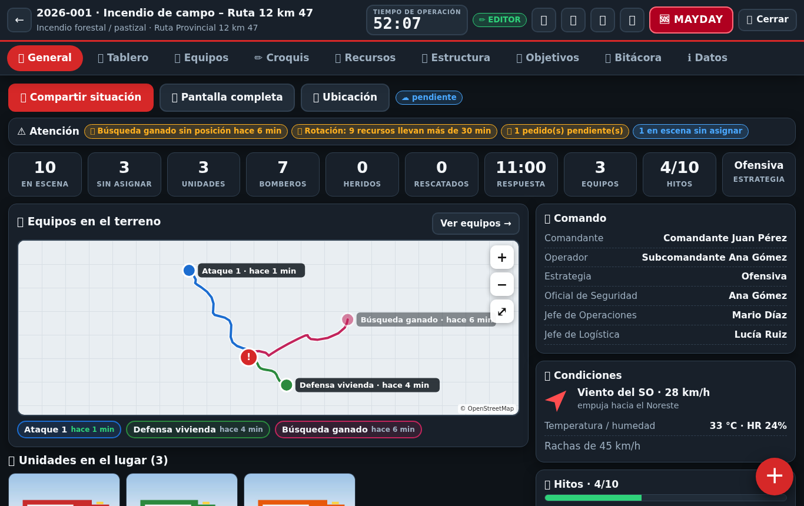
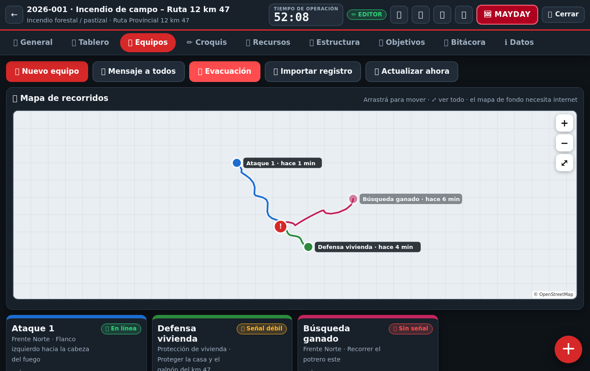
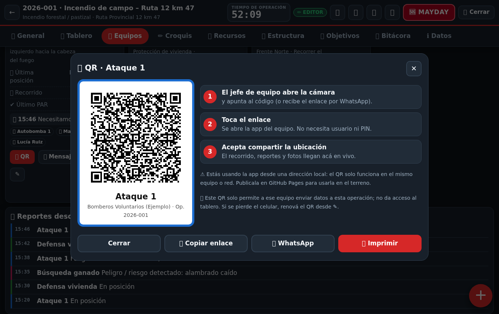
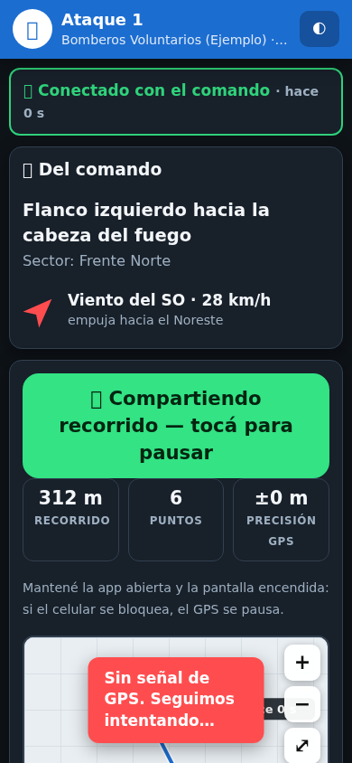
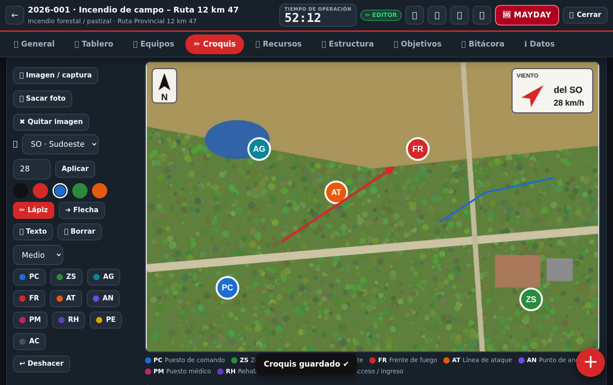
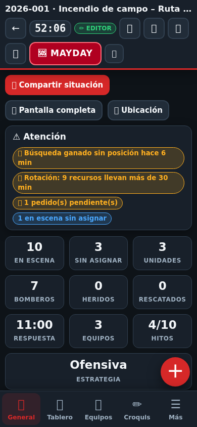
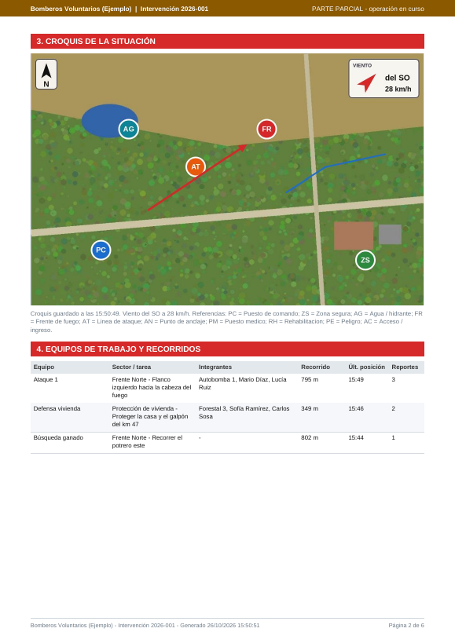

# 🚒 SCI Bomberos — Comando de Incidentes

**Tablero de comando para incendios, rescates y emergencias.** Pensado para cuarteles de bomberos de Argentina, en español y con la estructura del Sistema de Comando de Incidentes (SCI). Funciona en **computadora, tablet y celular**, se instala como app y **sigue funcionando sin señal**.

**[▶ Abrir la app](https://TU-USUARIO.github.io/sci-bomberos/)** · [Guía rápida](docs/GUIA_RAPIDA.md) · [Publicar en GitHub](docs/PUBLICAR.md) · [Nube para equipos en vivo](docs/NUBE.md)

> 🎬 ¿Querés verla sin cargar nada? En la pantalla inicial tocá **«Probar con datos de ejemplo»** (todos los PIN: `1234`).



## Qué hace

| | |
|---|---|
| 🏠 **Cada cuartel con su espacio** | Personal con perfil y PIN, unidades con foto, historial de intervenciones. |
| 🧭 **Tablero de comando** | Sectores y divisiones, recursos (propios y de otras instituciones), PAR con alarma, rotación, rehabilitación, estructura SCI y estrategia. |
| 👥 **Equipos con QR** | El jefe de equipo escanea el QR y, **sin usuario ni PIN**, envía su **recorrido GPS**, reportes, fotos, PAR y MAYDAY. Recibe tarea, viento, mensajes y la **orden de evacuación**. |
| 🗺 **Mapa de recorridos** | Todos los equipos en el mapa con su última posición y antigüedad del dato. |
| 🫁 **Control de ERA** | Ingreso con equipo de respiración autónoma por equipo, con avisos a los 5 min y al cumplirse el tiempo. |
| 🚨 **MAYDAY y evacuación** | Siempre a mano; la evacuación muestra cuántos equipos confirmaron. |
| ✏ **Croquis** | Sobre una captura o foto del lugar: puesto de comando, zona segura, agua, frente de fuego, líneas de ataque, peligros. Norte y viento automáticos. |
| ⚡ **Rápido de usar** | Guía de primeros pasos, botón **＋** de acción rápida, dictado por voz, barra inferior en el celular, modo claro/oscuro. |
| 📤 **Traspaso de comando** | Si el comandante se va, la operación pasa a otro dispositivo (archivo o nube). |
| 📄 **Informe PDF** | Estilo SCI-201 / 207 / 211: croquis, organigrama, equipos y recorridos, fotos, víctimas, bitácora y **resumen para cargar en RUBA**. |

## Capturas

| Equipos y recorridos | QR del equipo | Celular del equipo |
|---|---|---|
|  |  |  |

| Croquis con viento | Celular del comando | Informe PDF |
|---|---|---|
|  |  |  |

## Cómo empezar
1. **Publicala** en GitHub Pages siguiendo [docs/PUBLICAR.md](docs/PUBLICAR.md) (10 minutos, sin programar).
2. Abrí la dirección en cada tablet o celular y **instalala** (*Agregar a pantalla de inicio*).
3. Creá el cuartel, cargá personal y unidades, y **exportá el respaldo** para importarlo en los demás dispositivos.
4. (Opcional) Activá la **[nube del cuartel](docs/NUBE.md)** para ver a los equipos en vivo.

## Cómo funcionan los datos
- Todo se guarda **en el navegador de cada dispositivo**. No hay servidor propio ni cuentas.
- Sin nube: cada dispositivo es independiente; el traspaso y los registros de equipo viajan como **archivo** (WhatsApp, correo).
- Con nube (script gratuito en la cuenta de Google del cuartel): equipos con QR **en vivo**, respaldo automático, **seguir en vivo** desde otro dispositivo y **correo con el PDF** al cerrar.

## Límites conocidos
- El PIN y los permisos se aplican **dentro de la app**: ordenan quién opera, no son seguridad fuerte ante alguien con acceso técnico al dispositivo.
- El **GPS se pausa** si el celular del equipo se bloquea o la app queda en segundo plano (limitación de los navegadores).
- El mapa de fondo y el dictado por voz necesitan internet; los recorridos y todo lo demás funcionan sin conexión.
- El PDF es una **ayuda**: verificá los datos antes de cargarlos en RUBA.

## Estructura del proyecto
```
index.html              Página única de la app
css/app.css             Estilos (claro/oscuro, celular, tablet, computadora)
js/                     Código (sin dependencias ni compilación)
  core.js cuartel.js op.js extras.js general.js equipos.js envio.js team.js demo.js main.js
  pdf.js report.js      Generador de PDF propio
  qr.js map.js geo.js   QR, mapa y coordenadas propios
apps-script/Code.gs     Nube opcional (Google Apps Script)
sw.js manifest.webmanifest icons/   Instalación y uso sin señal
docs/                   Guías y capturas
.github/workflows/pages.yml         Publicación automática en GitHub Pages
```

## Licencia
[MIT](LICENSE): se puede usar, copiar y adaptar libremente, también en otros cuarteles.
